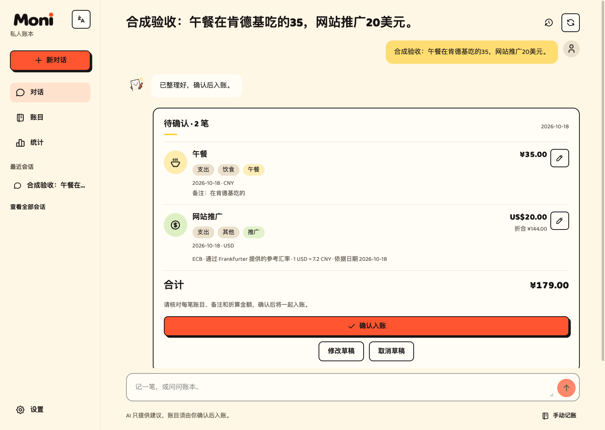
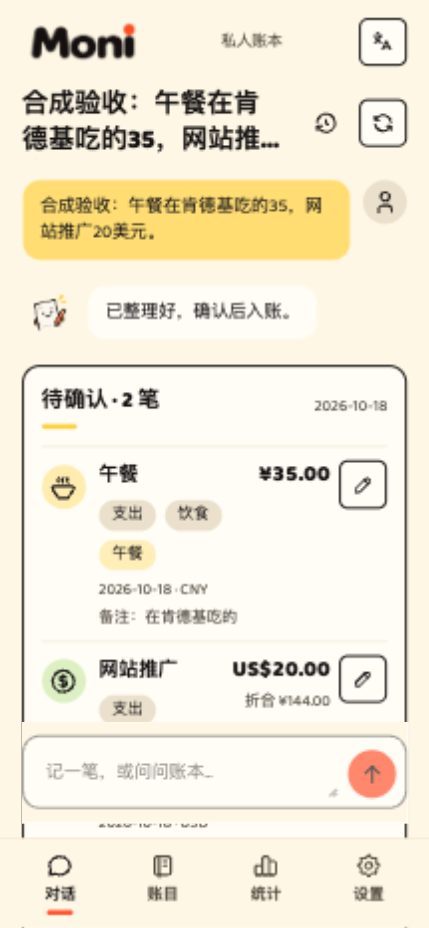
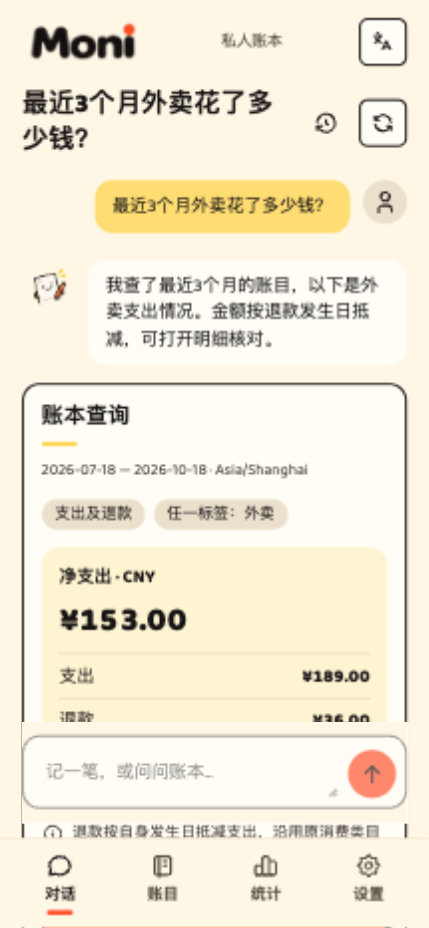

<p align="center">
  <picture>
    <source media="(prefers-color-scheme: dark)" srcset="public/moni/brand/wordmark-on-dark-v2.png">
    
  </picture>
</p>

<h1 align="center">说句话，就能记账。</h1>

<p align="center">
  开源私人账本，支持网页对话和微信 ClawBot 记账。<br>
  全部部署在你自己的 Cloudflare 账号里。<br>
  <strong>Cloudflare 免费额度内，托管费用为 0；AI Token 用多少付多少。</strong>
</p>

<p align="center">
  <a href="README.md">English</a> · 简体中文
</p>

<p align="center">
  <a href="https://deploy.workers.cloudflare.com/?url=https://github.com/ISheepp/Moni"></a>
</p>

## 花了什么，直接说

> 午餐在肯德基吃的 35，网站推广花了 20 美元。

Moni 会把这句话拆成两笔账，建议类目和标签，把商家等细节保留在各自的备注里。你自己创建的类目和标签也会参与识别。

先看草稿，有不对的地方直接改，再确认入账。也可以在设置里主动开启「直接入账」。缺少金额或币种不明确时，仍需要补充。



## 微信 ClawBot 里，也能直接记账和查账

**不用打开网页，在微信里发消息就能用。** 部署好 Moni、配置 AI 后，到「**设置 → 微信入口**」扫码连接 ClawBot。

像平时聊天一样发送：

> 午餐在肯德基吃了 35。
>
> 最近 3 个月，我在外卖上花了多少钱？
>
> 那上个月呢？具体的账目给我看一下。

- 记收入和支出，自动建议类目、标签，保留逐笔备注。
- 在同一个微信会话里连续追问。
- 看过草稿后，自然回复「确认」「记上吧」即可；也能一起核对待入账草稿，在微信里批量确认。
- 与网页共用同一本账本和记账权限，两边都能看到正式账目。

微信接收器也运行在 Cloudflare 上，不用电脑一直开着，也不用另外部署桥接服务器。详细连接方式见[微信接入说明](docs/wechat-integration.md)。

## 想查什么，也直接问

> 最近 3 个月，我在外卖上花了多少钱？
>
> 那上个月呢？
>
> 具体的账目给我看一下。

同一会话里可以连续追问，保留刚才的筛选条件。金额由程序查询正式账目后计算，还能打开对应明细核对。

<table>
  <tr>
    <th>手机上随手记一笔</th>
    <th>直接问消费情况</th>
  </tr>
  <tr>
    <td></td>
    <td></td>
  </tr>
</table>

截图使用演示数据，展示 v0.1 界面。应用同时支持中文和英文。

## 还有这些功能

- **自然语言记账**：一句话记多笔收入或支出，自动建议类目和标签，逐笔备注可编辑、可检索。
- **自然语言查账**：按时间、类目、标签、币种查询，支持明细和连续追问。
- **可选微信入口**：在设置页扫码连接 ClawBot，同一本账本、独立微信会话，支持草稿提醒和批量确认。
- **多币种**：保留原币金额和固定主币折算，可用参考报价、手填汇率或实际扣款金额。
- **日常账本工具**：手动记账、关联退款、组合筛选、统计、回收站、自定义类目和标签合并。
- **数据导出与备份**：筛选结果导出 CSV，完整账本导出 JSON 并恢复，逐笔备注随数据保留。
- **手机和 PC**：中英文、浅色、深色及跟随系统主题。

不配置 AI，也能使用手动记账、筛选、基础统计、手填折算和备份恢复。

## 全部 Cloudflare，不用养服务器

| 部分 | 使用的服务 |
| --- | --- |
| 网页和 API | Cloudflare Workers |
| 账目、备注和聊天历史 | Cloudflare D1 |
| 会话协调和可选微信接收器 | SQLite Durable Objects |
| 仅本人可访问的登录保护 | Cloudflare Access |
| AI | 自选支持工具调用的 OpenAI 兼容服务 |

应用和数据存储都在**你自己的 Cloudflare 账号**里，AI 请求发送给你配置的服务商。不需要 VPS、单独的数据库服务，也没有 Moni 订阅费。

### 到底要花什么钱？

**在 Cloudflare 免费额度和运行限制内，托管费用可以为 0；AI Token 费用由你选择的服务商收取。** 选用 Cloudflare 付费套餐或购买域名，需要承担对应费用。可选微信接收器也会消耗 Durable Objects 的请求和运行时长额度。

具体额度以 Cloudflare 最新的 [Workers](https://developers.cloudflare.com/workers/platform/pricing/)、[D1](https://developers.cloudflare.com/d1/platform/pricing/)、[Durable Objects](https://developers.cloudflare.com/durable-objects/platform/pricing/)、[Access](https://www.cloudflare.com/zero-trust/products/access/) 和[构建限制](https://developers.cloudflare.com/workers/ci-cd/builds/limits-and-pricing/)为准。

## 部署流程

准备一个 GitHub 账号和一个 Cloudflare 账号。先把应用部署好，AI 和微信都可以之后再配。

### 方式一：自己操作

1. 点击 [**Deploy to Cloudflare**](https://deploy.workers.cloudflare.com/?url=https://github.com/ISheepp/Moni)，登录并连接仓库。这一步不用填写 AI Key 或微信凭据。
2. 保留构建命令 **`pnpm run build`** 和部署命令 **`pnpm run deploy`**。Cloudflare 准备 Worker、D1 和 Durable Objects，部署命令会执行数据库迁移。
3. 打开生成的 `workers.dev` 地址，按页面引导启用 **Cloudflare Access 的 All traffic 保护**，只允许本人访问，并将 `ACCESS_ISSUER`、`ACCESS_AUDIENCE` 和 `OWNER_SUBJECT` 配为 Worker Secrets。完成前，业务数据不能访问。
4. 本人登录后选择主币种和时区，就能开始使用账本。
5. 需要 AI 时，在「**设置 → AI 助手**」填写 Key、Base URL、模型和接口类型；需要微信时，在「**设置 → 微信入口**」扫码连接。

自定义域名是可选项。Access 的详细配置、CLI 部署和升级方式见[部署指南](docs/deployment.md)。

### 方式二：交给 Agent

把仓库地址和下面这段话发给你的编程 Agent。账号登录和身份验证需要时由你亲自完成；AI Key 等部署后再到网页设置里填写。

```text
帮我把 https://github.com/ISheepp/Moni 部署到我的 Cloudflare 账号。

先阅读 README.zh-CN.md 和 docs/deployment.md。可以走 Deploy to Cloudflare
流程；如果已有 CLI 登录态，也可以使用 Wrangler。

部署 Worker、D1 数据库和 SQLite Durable Objects，执行数据库迁移，
配置仅允许我本人访问的 Cloudflare Access。
如果走 CLI，先创建或绑定 D1，再执行远端迁移，并确保构建与部署
使用同一份私密资源配置。遇到账号登录或身份验证，让我亲自完成。

密钥、本人身份、账号 ID 和个人资源配置不能进入 Git、日志或聊天。
使用已被 Git 忽略的本机配置和 Cloudflare Secrets。
升级时保留已有数据和加密密钥，不要改动其他项目的资源。

完成后打开部署地址，检查存储就绪，未登录不能读取账目。
AI 和微信留到部署后的网页设置里配置。
```

## 密钥和隐私

网页填写的 AI Key 在服务端加密保存，保存后不回显，也不进入账本备份。部署会生成加密密钥，升级时要保留。微信通过设置页扫码连接。

真实密钥和个人部署配置不要提交到 Git。本地开发使用被忽略的 `.dev.vars`，仓库里的[配置示例](config/local.vars.example)只包含空值。

## 本地开发

需要 Node.js 22.16+、pnpm 10.30.3+。

```bash
pnpm install --frozen-lockfile
pnpm db:migrate:local
pnpm dev
```

本地浏览器同样需要有效的本人 Access 身份。自动化测试使用独立签名身份和本地真实 D1／Durable Objects，不读取 `.dev.vars`。

| 命令 | 用途 |
| --- | --- |
| `pnpm check` | 格式、翻译、单元与 Worker 测试、类型检查 |
| `pnpm build` | 生产构建与类型检查 |
| `pnpm e2e` | 构建后运行手机和 PC 浏览器测试 |
| `pnpm check:private` | 检查源码和构建产物是否含私密配置 |
| `pnpm deploy:dry-run` | 对已有构建打包，不发布 |
| `pnpm locale:compile` | 修改翻译后重新生成语言文件 |
| `pnpm cf-typegen` | 重新生成 Cloudflare 绑定类型 |

`pnpm deploy` 会发布已有构建并执行远端迁移；`pnpm deploy:local` 会先构建再发布。两者都会改变云端资源，执行前请阅读[部署指南](docs/deployment.md)。

使用 React、TypeScript、TanStack Start／Router／AI、Base UI、Tailwind CSS 和 Paraglide；图标来自 Tabler。

## 项目文档

- [产品规格](docs/specs/moni-v0.1.md) · [技术方案](docs/technical-design.md) · [财务规则](docs/adr/) · [领域词汇](GLOSSARY.md)
- [微信接入](docs/wechat-integration.md) · [部署指南](docs/deployment.md)
- [v0.1 验证记录](docs/verification/v0.1-acceptance.md) · [最近的会话调用优化](docs/verification/chat-call-efficiency.md)

当前版本为 v0.1。

## 许可与致谢

[MIT](LICENSE)。项目从 [TanStarter Lite](https://github.com/MkFastHQ/mkfast-lite) 起步，保留原作者版权声明。插画和字标来源见[素材说明](docs/design/moni-v0.1/assets/README.md)。
