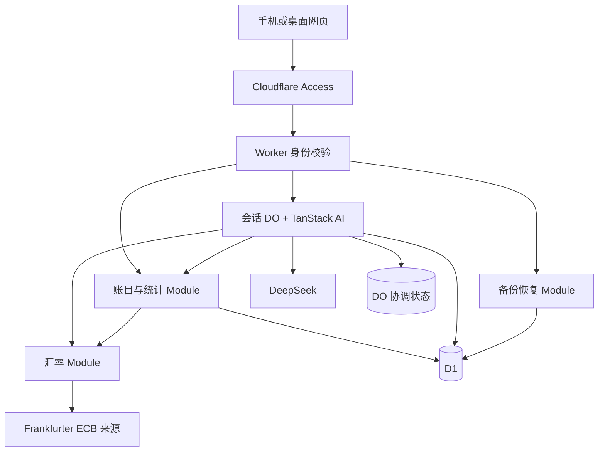

# Moni v0.1 技术方案

日期：2026-10-18。依据：[定稿需求](../PRODUCT.md)、[术语表](../GLOSSARY.md)、[退款决策](adr/0001-refunds-by-occurrence-date.md)、[换算决策](adr/0002-confirmed-currency-conversion.md)。

已确定采用 D1 + Durable Objects（DO）：继续使用现有 TanStack Start 应用，以一个 Worker 部署单元提供页面和受保护的业务入口，并导出会话 DO 类。D1 保存账本、草稿、完整会话历史与运行记录；每个会话一个 DO，负责 AI 回合执行与并发协调。手动记账、AI 草稿确认、报表和自然语言查账共用账目规则与查询实现。

本文件是技术建议与实施依据，不改变已定稿功能范围，也不代表已安装应用依赖、完成实现或获得编码和部署授权。已先下载官网指向的官方 skills，再复核接口与源码。阶段顺序见[实现计划](implementation-plan.md)；平台依据见[平台核查](research/2026-10-18-platform-feasibility.md)，SDK 细节与资料冲突见[官方 skill 复核](research/2026-10-18-tanstack-official-skills.md)。

前期平台与 SDK 研究保留 D1 单独协调的可行性讨论；当前会话架构以本文件的 D1 + DO 决定为准。后续已确认的微信可选入口见 §8.6，其具体排期及接收层实现尚未确定。

## 1 现有基础与改造范围

现有 React 19、TanStack Start/Router、Cloudflare Vite 插件、Tailwind v4、Paraglide、Vitest 和 Playwright 可以沿用。目前没有账目、AI、D1 或应用鉴权实现。

| 现有位置 | 后续用途与必要调整 |
| --- | --- |
| `src/routes/`、`src/router.tsx` | 建立私有应用路由与会话地址，保留文件路由机制。 |
| `src/routes/__root.tsx`、`src/components/layout/` | 将展示站布局替换为聊天、账目、统计、设置的应用布局；沿用主题和基础可访问性。 |
| `src/components/ui/` | 复用按钮、菜单、表单周边样式；账目表单和查询结果卡片按功能新增。 |
| `src/lib/locale.ts`、`project.inlang/messages/` | 扩展页面语言切换及消息，不再只处理首页锚点。保留现有 Paraglide 插件和生成方式。 |
| `src/config/website.ts`、SEO 与 manifest 路由 | 更新 Moni 身份；私有应用使用 noindex，sitemap 不列出账目或会话。 |
| `wrangler.jsonc`、Worker 入口、`.gitignore`、配置示例 | 增加 D1、DO binding、DO 类导出与迁移配置，核对与 TanStack Start 入口的兼容方式；补齐 `.dev.vars*` 忽略规则，基础仓库保留 `workers.dev` 和空白示例。 |
| `AGENTS.md`、`README.md`、`DESIGN.md` | 实施时同步模板假设，继续保留生成文件、密钥和个人部署信息的保护规则。 |
| `tests/unit/core.test.ts`、`tests/e2e/home.spec.ts` | 替换展示站身份、应用路由必须 404、公开 sitemap 等过时断言；保留适用的主题、语言、移动端与键盘操作检查。 |

生成的 Paraglide 文件、路由树和 Worker 类型仍通过原有工具再生成。

## 2 总体结构

页面请求与服务端函数由 Worker 入口处理；鉴权后的聊天请求经内部 DO binding 路由到对应会话 DO，由它运行 TanStack AI 并向客户端转发 SSE。DO 调用共享账目与汇率 Module，无需绕回公开 HTTP 接口。D1 用原生 binding 与预编译语句访问，迁移使用 Wrangler SQL migrations；DO 另行配置类迁移与自身协调状态初始化。

DO 以部署环境、可信 owner、`dataset_id` 和会话 ID 确定身份，同会话的多设备请求进入同一对象，不同会话分别协调。这利用了 DO 按唯一标识集中处理请求的能力，具体回合协议仍由应用定义。[DO 官方说明](https://developers.cloudflare.com/durable-objects/concepts/what-are-durable-objects/)

首版不预设 Queues、KV、R2、向量库或独立 Agent 框架。DO 只保存可重建的协调状态，业务备份所需数据全部在 D1；恢复聊天历史仍不要求同一输出流跨断线继续运行。

## 3 Module 与 Interface

路由只处理协议、输入和响应。规则集中在少量 Module，通过小 Interface 服务 UI、AI 工具和测试；直接使用 D1，不为每张表建立一套通用 Repository 或 ORM。

| Module | 建议位置 | Interface 承担的职责 |
| --- | --- | --- |
| 身份 | `src/server/access.ts` | 验证请求身份，提供服务端可信的 owner、活动数据集和访问范围。 |
| 金额与日期 | `src/ledger/` | 金额精度、换算、退款尾差、相对日期与月度区间，保持可独立验证。 |
| 账目 | `src/server/ledger.ts` | 准备与确认草稿、修改、退款、删除恢复、分类维护、筛选和统计；统一不变量与 D1 写入。 |
| 汇率 | `src/server/currency.ts` | 获取并校验报价，返回来源、实际报价日期和换算方向；手填和实际结算使用同一金额规则。 |
| 会话与 AI | `src/server/chat.ts`、`conversation-do.ts`、`chat-persistence.ts` | Worker 校验与路由；DO 协调并执行 AI 回合；共享 TanStack AI 工具和上下文处理；D1 Adapter 按执行环境注入 binding、可信范围及回合写入凭据。 |
| 备份恢复 | `src/server/backup.ts` | 导出、版本化校验、预览、暂存和切换，隐藏分批导入与失败恢复。 |
| 输入契约 | `src/contracts/` | 命令、草稿、查询和备份的运行时校验及可序列化结构。 |

这些是建议位置，实施前不创建占位文件。仅在文件中的职责确实分离时再拆分，不添加多服务或通用插件架构。

## 4 身份与数据保护

### 4.1 两层访问检查

优先配置 Worker 级 Access，覆盖正式域名、`workers.dev` 与预览入口。Worker 侧仍验证 Access JWT 的签名、可信签发者、目标 audience、有效期和唯一 owner 身份；不能直接相信客户端提供的邮箱头或会话 ID。[官方依据](https://developers.cloudflare.com/workers/configuration/cloudflare-access/)

签名校验采用 JOSE 标准库并使用官方公钥集合，同时检查适用的 nbf 与 token 类型，仅接受已绑定的本人应用访问令牌，拒绝空 subject 与 service token。owner 以可信签发者与 subject 组合识别；Access team、audience 和允许的 owner 由部署侧配置，首次初始化也必须在身份检查之后，不能通过第一个访问者自动认领账本。

全局请求检查覆盖 SSR、server functions、普通接口、聊天流、导出与恢复。各 Module 的 Interface 再接收可信上下文，避免只保护 `/api/` 而漏掉其他服务端入口。未配置鉴权时默认拒绝业务访问。

DO 仅通过服务端 binding 调用，不另设可绕过 Access 的公开入口。DO 名称及内部身份上下文由已鉴权 Worker 构造；DO 执行前再检查 D1 中的会话归属、活动数据集和删除状态，不信任客户端自行指定 owner 或对象地址。

生产请求不提供“缺少 Access 就使用测试用户”的回退。测试通过受控身份替身验证正常行为，同时验证生产入口无法选择该替身。

### 4.2 密钥与缓存

- 2026-10-19 网页配置追加：DeepSeek Key 可由本人在 Access 保护的设置页提交，服务端以 AES-GCM 密文保存在独立 `service_configuration` 表，主密钥 `CONFIG_ENCRYPTION_KEY` 自动生成并保留为 Cloudflare Secret。Key 不从读取接口回传，不进入前端持久化、D1 明文、DO 协调状态、工具参数、日志或业务备份；恢复账本不改变服务配置。网页配置优先，清除明确禁用，不复活旧环境 Key。具体边界见[网页配置设计](web-configuration.md)。
- API 地址和模型只允许部署侧配置；聊天输入不能改变目的地址或让工具请求任意 URL。
- 私有 HTML、业务响应、会话和导出使用禁止共享缓存的策略；不将金融数据写入浏览器离线缓存。
- 预览与生产使用不同的 D1、DO namespace 和相应配置，预览只使用虚构账目；无法隔离时不启用可写预览。Access 保护、数据库隔离与 DO 隔离分别验证。
- 日志保留请求标识、阶段、耗时、错误类型和记录数量，不记录 JWT、Key、完整用户输入、完整模型请求或备份内容。
- 开源示例只提交变量名和占位值；个人账号 ID、自定义域名、真实 owner、凭据与备份不进入基础仓库。

## 5 数据模型

### 5.1 建议的表组

| 表组 | 主要内容 |
| --- | --- |
| `app_state`、`datasets` | 当前活动数据集指针、恢复锁、账本主币种、时区、版本与变更修订号。 |
| `entries` | 收入、支出、退款；记账日期、独立备注、原币最小单位金额、币种、主币种金额、换算依据、退款来源、删除状态及版本。 |
| `categories`、`tags`、`entry_tags` | 收支类目、标签和关联；默认类目使用稳定标识与翻译文本，自定义名称按原文显示。 |
| `drafts` | 待确认的多笔记账内容、逐笔备注、缺失项、换算依据、来源会话及版本；未确认不属于正式账目。 |
| 会话持久化表 | 会话目录、顺序消息、消息 parts、工具完成状态、D1 中的运行记录及当前回合写入凭据；物理表按安装版本的 TanStack AI 契约确定。 |
| `mutation_receipts` | 唯一操作标识、请求摘要和结果引用，支持重试返回既有结果；不用于实现完整修改历史。 |

所有可恢复业务表及会话存储都归属 `dataset_id`，关联关系使用带数据集范围的键。owner 和 Secrets 属于部署配置，不能由备份导入覆盖。

`dataset_id` 用于安全恢复，不向用户提供多个账本或历史账本版本。正常读写始终只操作活动数据集。

DO 自带的 SQLite 存储只保留当前回合标识、协调阶段、执行凭据和截止时间等小型状态，不复制账目或完整聊天历史。它不进入业务 JSON 备份；恢复后根据新数据集和 D1 记录重新建立协调状态，旧凭据不能恢复为可执行权限。

### 5.2 金额与日期表示

- 金额以币种的最小货币单位保存为整数，原币和主币种各自保留精度；币种支持清单至少包含 CNY、USD。
- 小数解析、比例与换算使用精确整数或有理数运算，进入数据库和响应前检查可安全表示范围；不用浮点乘法直接决定入账金额。
- 参考与手填汇率以明确方向和精确小数形式保存：一单位原币对应多少主币。实际结算以使用者确认的主币金额为准，显示的近似有效汇率不反过来覆盖该金额。
- 记账日期保存为日历日期，审计时间另存 UTC 时间。改时区只改变“今天”和查询区间解释，不改历史记账日期。
- “最近三个月”按日历向前推三个月，目标月份无对应日时取月末；明确问完整自然月时使用完整月份区间。

### 5.3 数据库内的不变量

唯一操作标识、必要字段、正金额、关联范围与有效枚举由数据库约束保护。累计退款、原支出修改、软删除和恢复之间的约束必须在数据库写入路径内生效。

建议使用 D1 支持的事务性 batch，结合约束及触发器检查退款聚合、活动数据集和预期版本；约束失败使整批回滚。不能把“先查询累计退款，再由应用判断是否可插入”当成并发保证。

条件更新影响零行本身不等于 batch 失败。因此涉及多条语句时，要有能令整批中止的数据库检查，并验证冲突重试不会留下部分写入。具体触发器与批处理组织列入 S0 验证，不在文档中假定已经通过。

相同操作标识、相同请求摘要返回原结果；相同标识、不同内容拒绝执行。恢复、合并标签、确认多笔草稿等操作也经过相同保护。

DO 只协调单个会话的 AI 回合，不能覆盖手动记账、其他会话和恢复操作之间的竞态。金额、退款上限、正式入账幂等及活动数据集检查仍在 D1 内执行。聊天快照和工具草稿写入还需核对当前回合凭据、截止时间及会话状态，阻止已超时、删除或替换的执行者迟到提交。

### 5.4 账目备注

每笔正式账目及对应草稿项保留独立的纯文本备注字段 `note`，选填、默认空。输入与备份导入采用同一类型和长度校验，不静默截断；展示按纯文本处理。

AI 只整理本人明确提供的信息，例如“午餐在肯德基吃的 35”保留备注“在肯德基吃的”；多笔草稿逐项关联，不把整段输入的其他消费描述复制到每一笔。确认入账时一并保存本人核对后的备注，手动新增、编辑及退款均可单独填写。

修改或清空备注走现有版本检查与写入路径；不触发重新取汇率或改动金额。备注不依赖聊天历史存在，删除会话后仍随正式账目保留，日志不记录完整备注。

## 6 多币种与退款

汇率 Interface 接收原币、主币和账目日期，返回明确 ECB 来源、实际报价日和报价。查询不到适用报价时保持草稿待补，不能用未来报价或模型猜测补齐。

确认时冻结原币金额、采用汇率、来源、报价日期和主币金额。后续编辑影响换算的字段时，重新生成待确认结果；仅改类目、标签或备注不取新汇率。外部报价服务不可用不影响历史报表。

退款引用原消费，分类与标签通过原消费归属查询，不作为收入。默认按原消费确认的换算比例计算，累计原币退款不得超过原支出。

分次默认退款按累计比例处理舍入尾差，确保最后一次全额退款精确冲回原折算金额。明确提供实际退款金额时优先采用实际值，并允许其造成的差额留在净支出中，不新增汇兑损益模块。

输入、编辑、删除、恢复和并发退款共用同一规则。已经删除的退款不计入累计退款，但恢复时必须重新校验余额；有退款的原消费改币种、删除时必须先处理关联退款。

## 7 统一查询与统计

UI 筛选、报表、导出和 AI 查账共用结构化查询 Interface。输入限定为日期区间、账目类型、原币种、类目和标签标识、关键词、分组方式与分页，不接受模型生成的任意 SQL。

关键词条件覆盖账目备注及名称。“最近 3 个月在肯德基花了多少钱”可转为对应日期区间与关键词“肯德基”，通过同一查询计算支出、退款和净支出，并返回筛选条件及明细入口；不要求先存在“肯德基”标签。备注修改后，后续查询使用当前内容。

相对日期由 AI 解释为结构化意图，再由程序按账本时区解析。标签或类目无法唯一确定时返回澄清问题，不静默扩大查询范围。

查询仅包含活动数据集中的正式、未删除账目。退款按自身发生日、原消费分类归属统计；不能要求原消费也必须位于同一时间区间。标签筛选避免关联多标签造成金额重复累加。

统一返回支出、退款、净支出、收入、笔数、日期区间和可重查的筛选条件。总额按主币种计算；指定原币时限定该币种并同时返回原币和折合金额。零净支出与没有匹配记录是不同结果。

聊天中的金额、日期、条件和明细入口由程序根据查询结果渲染；模型负责理解和组织回答，不负责重新算钱。保存的旧结果卡片保留当时含义，新的追问必须查询当前数据。

首版用日期等条件索引、分页和直接聚合。标签使用稳定标识，关键词使用受参数约束的文本筛选，不预先引入全文索引、向量检索或数据仓库。

## 8 TanStack AI 与会话

### 8.1 依赖选择

官网的 [Agent Skills 安装指引](https://tanstack.com/ai/latest/docs/getting-started/agent-skills)区分发现入口和包内 API skills。本项目已将三组官方原文下载到 `.agents/skills/tanstack-ai/`、`.agents/skills/ai-core/`、`.agents/skills/ai-persistence/`，固定官方仓库提交 `85c2956c68f3226ef409b3a4e54d5be82198931e`；[来源与校验记录](../.agents/upstream/tanstack-ai/manifest.json)保留对应路径和 MIT 许可。这一步只增加研究资料。

计划使用 `@tanstack/ai`、`@tanstack/ai-react`、`@tanstack/ai-openai` 和 `@tanstack/ai-persistence`。skill 的 `library_version` 与当前发布版本存在差异，不能据此安装旧版本；版本核对结果集中在复核笔记，S0 再锁定兼容包组，并以该版本的源码、类型和随包 skills 为准。

DeepSeek 使用 `@tanstack/ai-openai/compatible` 的 `openaiCompatible`，部署侧提供 `baseURL`、Secret 和模型定义，默认走 Chat Completions。显式声明所选模型的文本、工具与结构化输出能力；不用裸模型名的乐观默认推定原生 JSON Schema 或工具与 Schema 同时可用。先由工具参数及运行时校验产出草稿和查询结果，是否启用额外结构化输出模式由 S0 及真实服务验证决定。

React 使用 `@tanstack/ai-react` 的 `useChat`，服务端使用官方 SSE 响应工具。保留 SDK 的消息 parts 与错误协议，不自行实现一套流式协议。

D1 适配器采用官方 [Cloudflare recipe](../.agents/skills/ai-persistence/build-cloudflare-adapter/SKILL.md)的应用内工厂模式：在 Worker/DO 执行环境中注入 D1 binding、可信数据集与会话范围；写入工厂再绑定当前回合凭据，不能只在进入 DO 时检查一次。迁移继续使用 Wrangler。首版实现 `messages` 和用于执行状态的 `runs`；财务确认由业务草稿承担，不因此增加 SDK `interrupts`、`metadata`、媒体或沙箱存储。适配器使用官方 conformance testkit，省略的可选能力明确记录；不单独发布适配器包。

会话协调使用原生 Durable Object，与同一 Worker 一起部署，不为此增加 Cloudflare Agents SDK 或另一套聊天框架。官方 `withLocks` 仅提供锁能力，`withPersistence` 也不自动锁住整轮；本方案由会话 DO 直接持有回合生命周期，首版不再并行维护 D1 分布式租约或通用 LockStore。

运行时输入校验建议统一使用 Zod，JWT 使用 JOSE 库。图表先由现有 UI 与小型 SVG/条形图实现；不为三类基础图表默认增加完整可视化框架。

### 8.2 工具与确认

2026-10-19 追加授权：本人可选择“由我确认”或“直接入账”，默认仍采用下列人工确认状态机。直接入账由程序在完整草稿校验后执行相同命令，并在 D1 事务内复核权限版本和运行凭据；微信内以明确自然语言同意代替网页按钮也使用相同命令。此授权例外及限制集中在[记账权限](posting-permissions.md)，不由模型自行修改权限。

| 工具职责 | 权限与结果 |
| --- | --- |
| 整理记账草稿 | 校验结构、识别缺失项，保存草稿并返回草稿标识；不能写正式账目。 |
| 获取汇率 | 只接收已校验币种和日期，不接收任意地址，也不发送消费描述。 |
| 查询账本 | 调用统一查询 Interface，返回当前统计与明细条件；只读。 |

财务确认是应用自己的草稿状态机：待补充、待确认、已入账或已取消。用户点击确认后，受保护的业务命令检查 owner、活动数据集、草稿版本和操作标识，再原子入账。模型输出、聊天中的“已确认”文字或伪造的工具消息不能代替这个动作。

这使业务确认可独立于模型工具循环恢复，不要求引入通用 Agent 审批引擎。草稿在新设备上再次点击确认，也只能产生一次入账结果。

### 8.3 历史与中断

会话消息、工具调用与工具结果按 SDK 支持的结构保存，不能只提取文本，否则后续工具上下文可能失配。前端提交的完整历史不作为权威记录，服务端根据已鉴权会话读取历史；读取恢复入口也必须校验 owner、活动数据集和会话范围。

官方根 skill 对非空输入使用“完整覆盖”的概括，但同提交的 server skill 与源码实际按消息 ID 合并：相同 ID 可以覆盖消息，并截断后续历史。`saveThread` 随后完整替换合并结果。这两层语义不能混为一谈，也不能由“server-authoritative”推定 SDK 自动拒绝伪造历史。资料差异和源码位置见复核笔记。

Moni 的正常新增回合采用以下应用协议，须在 S0 验证客户端与 SDK 的完整衔接：

1. 请求表达当前用户文本、会话、回合幂等标识及预期版本；客户端不能指定 assistant/tool 消息作为可信输入。
2. 鉴权后路由到对应 DO。DO 检查已有回合，并以短小的本地状态转换预留执行位置；同请求同输入回读已接纳状态，不同输入复用同标识则拒绝。另一个新请求在会话忙碌时返回忙碌状态，首版不在服务端积压队列。
3. DO 通过 D1 原子操作校验数据集、会话版本与幂等收据，分配服务端用户消息 ID，保存输入、`runId` 关联和本轮写入凭据。这是应用内追加命令，不是用单条新消息调用完整替换接口。D1 保存失败时不调用模型；结果不确定时先回读收据核对，不能直接重发。
4. DO 确认输入已保存后调用 `chat`，传入可信 `threadId`、已绑定 `runId`、`messages: []` 与 `withPersistence`，由适配器载入新输入及历史。空数组不能省略前一步而丢掉本轮输入；SDK 的 best-effort 开始快照不能替代可靠保存。
5. DO 消费 AI 流并转发 SSE，保存 SDK 完整消息与执行终态，待流和必要持久化完成后才释放回合。不能在返回 Response 时提前释放。业务草稿和正式入账结果仍以各自可靠保存的业务记录为准；刷新不将旧输入作为新请求重发。

D1 Adapter 的 `saveThread` 在同一会话版本下保留完整替换语义：分页读取已有逐行消息，计算差异，只将改变的行分块 upsert，并在同一个原子 batch 内删除真正被 SDK 移除的尾部。新输入通过单行追加可靠接纳，不重新序列化并覆盖整段历史。移除每会话 1,000 条／1 MiB 固定门槛；单条消息保留 256 KiB 的安全限制，备份整体的 10 MiB／100,000 行限制仍独立生效。网页默认按约 50 条模型消息分页并补齐边界回合，可加载更早消息；无分页参数的 SDK 权威读取仍返回完整数组。草稿确认状态不会被聊天快照覆盖。

### 8.4 DO 回合协调与异常恢复

每个会话同时只接受一个活动 AI 回合，协调阶段为待执行、准备中、运行中、收尾或故障核对；D1 的 SDK run 状态使用 SDK 自己的契约。不同会话可独立运行，其他会话的历史不自动进入当前上下文。

DO 在等待外部模型或 D1 调用时仍可能处理其他事件，因此显式检查并持久保存活动回合。短小的初始化和状态转换可使用本地事务或适用的事件阻塞；不把整个模型调用包进 `blockConcurrencyWhile`，该接口有超时限制。[并发机制](https://developers.cloudflare.com/durable-objects/api/state/#blockconcurrencywhile)

DO 的本地状态与 D1 之间没有跨存储事务。发生重启或保存结果不确定时，先核对 D1 的输入收据、运行记录及执行凭据，再决定显示已有结果、继续等待有效回合或使旧回合失效。失去原执行实例的回合不自动重调模型；先撤销旧写入权限并记录中断，再允许使用者明确重试。重试关联原输入，避免重复显示用户消息。

回合具有明确截止时间，每次启动模型或工具步骤前检查执行权限；DO alarm 用于超时核对和回收，状态查询遇到过期或不一致时也触发核对。alarm 处理必须幂等并匹配回合标识，旧 alarm 不能结束新回合。取消、超时或失效后尽力终止执行，D1 内容写入仍检查凭据与截止时间，不能以 alarm 及时触发或 AbortSignal 为唯一保证。DO 不替供应商提供恰好一次调用保证，用户明确重试可能产生新调用。[生命周期](https://developers.cloudflare.com/durable-objects/concepts/durable-object-lifecycle/)、[Alarms](https://developers.cloudflare.com/durable-objects/api/alarms/)

故障核对使用受控的条件终止操作：只撤销匹配旧回合的凭据，并将其 SDK run 标为适用的 `failed` 或 `aborted`，允许在截止时间后收尾，但不能补写消息、草稿或终止新回合。界面可显示“已中断”，不将一般断线映射为用于人工等待的 SDK `interrupted` 状态。

D1 中的凭据只用于拒绝迟到写入、重放和跨数据集操作，不再承担多个普通 Worker 抢占/续租的协调协议。DO 自身故障恢复、跨存储核对与 D1 拒绝路径均须经过 S0 验证。

### 8.5 上下文与断线处理

官方源码与文档区分完整的 `messages` 和临时的 `providerMessages`。2026-10-19 使用者批准在同一微信会话中使用自动摘要和滑动窗口，完整历史保留，不再因历史达到 40 条／32 KiB 要求新建会话。

接入官方 `@tanstack/ai-compaction 0.2.0`，在 `withPersistence` 之后运行 `withCompaction + summarizeOldest`，每次模型调用仅投影 `providerMessages`。本地预算为 16,000 个保守估算 token，通常保留最近约 8,000 token 的完整回合，至少保留当前用户输入及全部工具调用／结果；预留摘要空间。估算按 UTF-8 字节和消息开销计算，非厂商精确 token 计数，系统提示、工具定义及输出另留空间。摘要通过同一私密模型生成，按有界批次滚动合并，不调用业务工具；检查点由官方中间件存到现有 D1 metadata store，校验来源前缀后跨 DO 重启复用。

摘要失败、为空或过长时，保留原历史和最后有效检查点，使用官方 `evictOldest` 回退到保留完整近期回合的窗口；不把失败结果写成新检查点。摘要不代表金额、草稿状态或入账许可；`get_ledger_context` 从 D1 读取当前草稿，连续查账由原始查询记录继承条件并重新统计正式账目。当前单轮本身过大时明确提示减少本次内容，保留已经保存的数据，不要求换会话。删除会话同时删除其摘要检查点；备份只含完整原始历史，恢复后检查点重新生成。未增加跨会话记忆。[调研版本边界](research/2026-10-19-tanstack-context-management.md)、[实现与验证](verification/chat-compaction.md)。

使用 DO 当前回合的流式响应，并持久保存已完成消息、工具状态与草稿。观察到连接取消时尝试中止回合，无法及时观察时依靠截止时间收敛状态。重新打开会话时，真实仍运行的回合显示忙碌，已中断的回合显示明确重试入口；不自动开启第二轮，不承诺未保存输出逐字恢复，也不自动重新执行入账动作。

React 客户端拟用 `persistence: true` 读取服务端历史；它不会自动构成上述输入协议。加载历史和状态不自动 join 或重放活动回合；对 SDK `activeRun` 默认行为的适配列为 S0 验证，不用返回虚假的空运行状态绕过它。

DO 用于集中协调会话，不代表已经实现输出日志重播或后台任务。首版仍不要求断线续流、自动后台继续、WebSocket 或 durable stream 服务。

### 8.6 微信可选入口与专用会话

已确认的产品关系是同一本账本、额外微信 ClawBot 入口、独立微信会话、网页可查看历史，详细决定集中在[微信入口设计](wechat-entry-design.md)。微信会话复用现有会话 DO、D1 历史存储和 TanStack AI 工具，来源标记不改变账目口径或会话互斥规则。

接收适配层先校验本人绑定并可靠接纳消息，再映射到当前数据集中的微信会话；不信任消息正文提供的 owner 或会话地址。Bot 账号级轮询与会话级 AI 执行分开，接收 DO 是待验证候选，不默认给每个会话启动轮询或增加 OpenClaw 宿主。

此通道的身份验证独立于网页 Access，网页保护继续保持。微信内自然语言确认与网页按钮均通过同一正式入账命令；本人另行开启直接入账时，由程序代为执行完整草稿确认。会话来源与历史属于可恢复业务数据，敏感通道凭据与旧执行权限不从备份恢复；本节记录设计，不自动扩大 S0–S6 的交付范围。

2026-10-19 追加待入账提醒及批量确认：提醒由当前会话草稿状态生成，不依赖模型自由正文。确认引用可绑定多份已完整展示的草稿 ID／版本，保留旧单份引用兼容；独立 TanStack AI 工具只分类意图，程序核对引用及状态后，复用草稿确认写入语句，在单次 D1 事务中写入整批账目和回执。缺失、修改、取消或并发状态变化要求重新核对，任何写入失败整批回滚；不完整或无法完整展示的内容不取得批量确认权。具体边界与验证见[微信接入](wechat-integration.md#待入账提醒与批量确认)。

## 9 导出与整本恢复

CSV 由同一账目查询生成，明确备注、原币与折合金额列、退款类型、日期和报价信息，并处理表格公式注入及文本转义。JSON 使用带版本号的专用备份格式，不直接导出数据库 SQL；覆盖全部可恢复业务数据、逐笔备注、会话和换算信息，恢复后备注完整保留。

导出需读取一致的数据修订版本，防止分批读取时混入一半旧账、一半新账；发生并发修改时重试或提示重新导出。文件大小、条数和消息体设置显式上限，超限在修改账本前拒绝，具体数值在 S0 实测后确定。

### 9.1 恢复流程

1. 校验备份版本、金额、币种、关联关系、退款约束和文件限制，返回预览；不改变活动账本。
2. 分批写入新的非活动 `dataset_id`，预览与导入绑定同一份内容摘要，每批可幂等重试；重新校验完整性后封存，拒绝迟到的上传继续改写。
3. 最终替换前短暂禁止活动账本写入，导出当时的一致备份并由使用者保存。
4. 使用者确认替换后，在数据库内检查旧活动数据集、修订版本和恢复执行权，再切换活动指针。
5. 客户端重新加载账目与会话；失败或取消时继续使用旧数据集。过期暂存和替换后的旧数据分批清理。

分批装载与最终切换是本项目的恢复设计，不是 D1 的内置备份接口。所有业务读写与会话 Adapter 必须限定活动数据集，数据库写入也要阻止切换前发起的旧请求继续写入已失效数据集。

恢复期间的写入锁同时阻止 DO 接纳新回合和提交消息/草稿。可以通知当前 DO 取消，但安全性依赖 D1 的活动数据集、恢复锁和回合凭据检查，不能以通知全部成功为前提。切换后按新 `dataset_id` 路由新 DO；旧 DO、旧 alarm 和旧输出流都不能修改新账本，也不能恢复已删除会话。DO 协调状态不导入，D1 中的旧执行凭据作废；备份中未完成的运行按适用的 `failed`/`aborted` 终态归档，界面保留历史中断说明。

恢复锁有可验证的超时和取消路径。过期锁不应永久阻断记账，过期执行者也不能随后激活旧任务。首次使用者自行保存的备份才是业务恢复依据，不依赖暂存表或无限保留旧数据。

切换后的前端丢弃旧数据集版本的响应和输出流；旧数据保留到在途读取的有效窗口结束后再清理，避免恢复成功后仍显示旧账或过早回收造成请求失败。

恢复后保留历史消息展示，但废弃恢复前未完成的确认执行权；需要操作的旧草稿重新核对并生成新确认，避免旧聊天按钮重放写入。

## 10 路由与交互建议

入口为聊天，新建会话后使用可恢复的会话地址；另设账目、统计、设置和回收站页面。英文路径与现有 `/zh` 前缀共用业务页面，语言包装与数据规则分开。

语言首次进入时按浏览器选择，显式语言路径与手动偏好优先；之后切换保留当前页面、会话与筛选条件。类目、标签等使用者数据不自动翻译。

页面保留键盘操作、可见焦点和明确错误；图表同时提供文字金额或表格，不能仅靠颜色表达收支。聊天中的草稿卡片、查询结果卡片与普通文字分开渲染，Markdown 不允许执行 HTML 或外部脚本。

## 11 配置与一键部署

部署配置分为 D1 binding、会话 DO namespace/class binding、Access team/audience/唯一 owner、主币种与时区、AI 地址/模型，以及独立 Secrets。Worker 入口保留 TanStack Start 的请求处理并导出 DO 类；DO 类迁移使用 Wrangler 的 `new_sqlite_classes` 配置，与 D1 SQL migrations 分开管理。具体入口及流转发方式先经 S0 验证，实施配置变化后再生成 Worker 类型。[DO 配置说明](https://developers.cloudflare.com/durable-objects/get-started/)

使用 Cloudflare 官方部署按钮创建 D1 并配置会话 DO；官方自动资源配置清单包含两者。部署流程按 D1 binding 名执行 SQL 迁移，DO 类迁移随 Worker 部署验证；实例资源标识由部署流程生成，不把个人信息写入基础仓库。正式与预览的 D1 和 DO namespace 分别隔离。[部署按钮官方说明](https://developers.cloudflare.com/workers/platform/deploy-buttons/#automatic-resource-provisioning)

Zero Trust 开通、Access 本人策略和用户自己的 AI Key 仍需部署者配置。首次指引给出具体步骤与配置状态，不能用“按钮已部署”替代真实访问保护验证；公开指引只包含无敏感信息的说明，初始化接口依旧受保护。

## 12 实施前验证与风险

| 事项 | 验证目标 |
| --- | --- |
| TanStack AI 版本与 D1 Adapter | 锁定版本后验证新输入、ID 合并、完整替换、上下文处理和官方 conformance；并发、失效执行权及 `activeRun` 恢复另行验证。 |
| 会话 DO | 同会话多设备仅一个活动回合，不同会话互不串历史；验证 DO 重启、截止时间、重复 alarm、流取消及终态保存失败。 |
| DO 与 D1 协同 | 预留前后、D1 接纳前后及模型调用前后的故障均可核对；过期凭据不能写入，普通重发不重复调用模型，失权后不自动重放。 |
| 并发与退款约束 | batch 与触发器/条件检查的组合在实际 D1 中原子失败；验证多设备退款、恢复、版本冲突和操作重放。 |
| 整本恢复 | 超过单批的数据可暂存，切换失败不影响旧账；旧 DO、alarm、输出流和备份中的未完成回合不能污染新旧数据集或恢复执行权。 |
| 汇率 | 验证明确 ECB 来源、历史与非报价日、缺失报价、零/二/三位小数币种及实际结算覆盖。 |
| DeepSeek | 所选模型实际支持需要的工具与结构化输出，不能由“兼容接口”推定所有模型能力。 |
| Access 与部署按钮 | 验证本人/非本人、缺配置和所有入口；核对全新部署的 D1/DO 绑定、两类迁移、入口导出和预览隔离。 |

上述是技术验证任务，不是已通过的测试。本方案不以未验证的性能、费用或线上安全结果作为结论。
